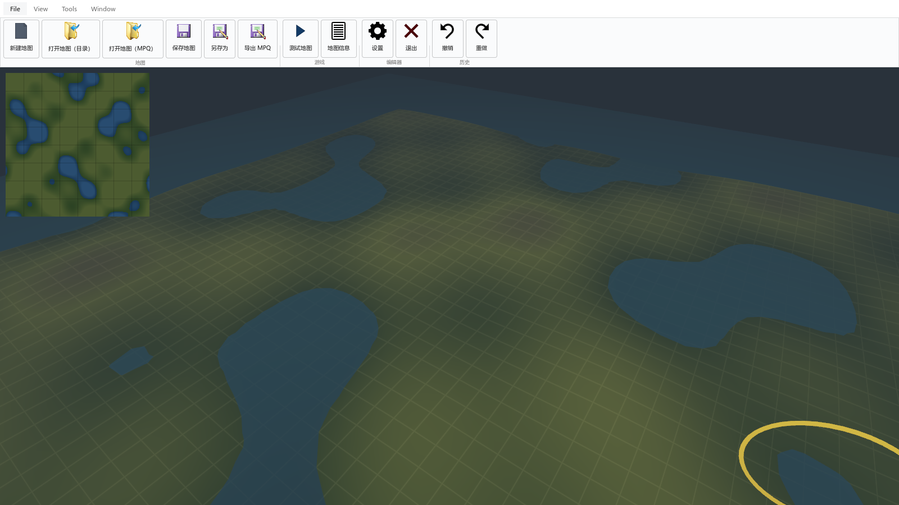
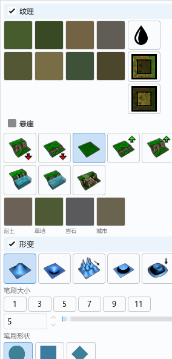

# 界面先行之后：RoadMap 修订

> 前置：`00-现状与经验.md`（为什么重写）、`01-RoadMap.md`（原计划）。
> 本文回答一件事：**界面先搭出来以后，原路线图哪些成立、哪些要改。**
> 记录时间：2026-11-05

---

## 1. 这次交付了什么

Godot 工程 `D:\WorldEditor\Godot` 现在可以启动，界面是 HiveWE 0.6 的复刻，**所有功能打桩**（点按钮只打印 `[STUB] id` 并弹提示）。

| 界面 | 对应 0.6 | 状态 |
|---|---|---|
| Ribbon（File / View / Tools / Window） | `MainRibbon.cpp` | 完成，含 4 页签分区与图标 |
| 调色板页签（打开调色板时追加） | `set_current_custom_tab` | 完成（地形 / 装饰物） |
| 地形调色板 | `TerrainPalette.ui` | 完成：8 纹理、4 悬崖类型、8 悬崖操作、5 形变、笔刷大小/形状 |
| 装饰物调色板 | `DoodadPalette.ui` | 完成：筛选、分类树、笔刷 |
| 寻路调色板 | `PathingPalette.ui` | 完成：三种路径、操作类型、笔刷、导入导出 |
| 地图信息 | `MapInfoEditor.ui` | 完成：描述 / 载入画面 / 选项 / 尺寸边界 四页 |
| 触发器编辑器 | `TriggerEditor.cpp` | 完成：树 + ECA 树 + 参数 + 脚本页 |
| 导入管理器 | `ImportManager.ui` | 完成：按钮 + 文件树 |
| 设置 | `SettingsEditor.ui` | 完成 |
| 修改地形集 / 瓦片寻路 / 替换瓦片 | `TileSetter/TilePather/TilePicker.ui` | 完成 |
| 小地图 | `Minimap.ui` | 完成（占位图，由同一高度函数生成） |
| 单位 / 区域 | **0.6 没有** | 新增占位 |
| 对象编辑器 / 玩家与队伍 / 模型预览 | **0.6 没有** | 新增占位（标「规划中」） |

代码量 2779 行 C#（不含 110 个图标/着色器资源），一次性构建通过，17 张截图逐屏核对。

调色板是独立的系统窗口，贴在主窗口右上角（下面是窗口自己的截图）：

---

## 2. 为什么「先做界面」是对的（方法论）

上一代的失败不在技术选型，在**契约倒置**：先有 C++ 核心，UI 要什么就加一个 C ABI 函数。界面的需求是被「挤」出来的，每加一个面板都要改核心的导出表。

界面先行反过来：**每个面板先声明它要什么数据**，契约由 UI 逼出来，而不是由格式层猜出来。

具体到这次，画完 14 个界面之后，`Core` 需要的 API 已经能列成一张表（第 5 节）。这比先写格式层的收益大得多：格式层写完再回头发现 UI 需要的是另一种形状，返工量最大。

代价也要说清楚：

| 代价 | 表现 | 应对 |
|---|---|---|
| 假数据会「看起来能用」 | `Defs.cs` 里有 8 张纹理、40 个装饰物、16 个单位 | 接真数据时整份删除，不做兼容 |
| 界面先于数据定稿 | 某些控件（如地图尺寸）字段可能不准 | 只做官方 WE 已有的字段，不自创 |
| 交互假象 | 笔刷环会跟着鼠标，但不落笔 | 打桩提示明确写「打桩」，不误导 |

---

## 3. 界面暴露出的功能缺口

把 0.6 的界面全画一遍，最大的收获是**看清 0.6 本身缺什么**——这些原本埋在代码里，界面一画就藏不住：

| 缺口 | 证据 | 原路线图位置 | 现在 |
|---|---|---|---|
| 地图尺寸与相机边界 | 0.6 的第四个页签只有一个 `?` 标签 | M7 | 界面已补，数据待接 |
| 单位调色板 | 0.6 完全没有，单位属性靠官方 WE | M6 | 界面已补 |
| 区域编辑 | 只读写 `w3r`，无界面 | M7 | 界面已补 |
| 对象编辑器 | 0.6 完全没有 | M8 | 界面已补骨架 |
| 玩家 / 队伍 | 0.6 有数据读写，无界面 | M7 | 界面已补 |
| 模型预览 | 0.6 没有 | M10 | 界面已补骨架 |
| 导入管理器真实功能 | 0.6 的导入/导出按钮连接被注释，退化成文件浏览器 | M10 | 界面在，功能待做 |
| 装饰物笔刷组 | 0.6 里 `brushGroupBox` 高度为 0，整组不可见 | M5 | 界面已补，标注了这一点 |

**结论：0.6 不是一个「功能齐全但界面难用」的编辑器，它本身就缺五块界面。** 原路线图把 M7/M8/M10 当作「移植」，实际是「新做」。这一点必须在排期里体现，不能按移植的工作量估。

---

## 4. Godot 侧实测结论

### 4.1 已验证可行

1. **1:1 复刻界面密度没问题。** 1600×900 下放得下 4 个 Ribbon 页签 + 5 个分区 + 8 个大按钮，右侧 318px 调色板放得下地形面板的全部控件。HiveWE 的 `Dark.qss` 配色可以整体搬到 Theme。
2. **中文不需要打包字库。** `SystemFont { FontNames = ["Microsoft YaHei UI", ...] }` 直接渲染，省掉一个 5–10 MB 的字体资源。这也意味着以后多语言可以走系统字体。
3. **图标可以整份复用。** `Data/Icons/Ribbon/*.png` 直接拷；`.ico` 是 BMP 格式，写了 30 行 Python 转成 PNG（`new/test/exit` 三个），没有丢图。
4. **SubViewport + Control 叠加可行。** 3D 用 SubViewport 渲染，UI 覆盖其上，小地图作为锚点子控件，截图一次拿全。
5. **截图自检链路成立。** `--shot=<path> --frames=N` + 参数化打开面板/窗口，17 张截图全部自动生成。这条链路以后就是 UI 回归测试的基础设施。
6. **弹窗可以是真正的系统窗口。** 把 `display/window/subwindows/embed_subwindows` 关掉后，`Window` 节点就是独立窗口，能拖出主窗口、放第二块屏幕。实测：主窗口纵跨 `396..996`，子窗口摆在 `(900,120)` 完全在外，位置不被打回。代价是主窗口截图拍不到子窗口，`--shot` 会额外存一张 `xxx-window.png`（子窗口自己的渲染目标），截图链路仍然成立。

### 4.2 踩到的坑（都可复用）

| 坑 | 现象 | 原因 | 解法 |
|---|---|---|---|
| CheckBox 被主题「按钮化」 | 一行「替换 / 添加 / 移除」变成三根蓝色长条 | 给 `Button` 设的 stylebox 被 `CheckBox` 继承 | 单独给 `CheckBox` 设透明 stylebox，只保留勾选图标 |
| 按钮最小高度不由 `CustomMinimumSize` 决定 | Ribbon 里三个 flag 只能显示两个，第三个被裁 | Button 的最小高度 = 字号 + stylebox 上下 content margin | 给紧凑按钮单独做 `ContentMarginTop/Bottom = 0` 的 stylebox |
| HBox 里两个 Tree 都不 Expand | 对象编辑器右侧字段树宽度为 0，看上去是空白 | 两个子控件都是 `Fill`，剩余空间没人要 | 给右侧树 `SizeFlagsHorizontal = ExpandFill` |
| `.ico` 不被 Godot 导入 | 图标缺失 | 引擎不支持 ICO | 转 PNG（BMP 内嵌，解析 ICONDIR 即可） |
| `Page()` 里提前把控件挂到别的父节点 | 运行时 "already has a parent" | 辅助方法顺手 add 了一次 | 工厂方法只造不挂 |
| 4 层纹理混合要用 `cull_disabled` | 地形完全不可见，只剩水面 | 三角形绕序与 Godot 的正面约定不一致 | mock 阶段先关剔除；真实地形按 Godot 绕序生成 |

### 4.3 还没验证

- **Tree 的大数据量**：0.6 的装饰物有 716 种、地图里 2011 个实例。Godot 的 `Tree` 会不会卡，要等真数据。
- **缩略图批量生成**：装饰物列表按图标预览需要把 BLP 转成 `ImageTexture` 并缓存，数量级 700+，要做异步与显存预算。
- **高 DPI**：当前 `stretch/mode = disabled`，150% 缩放下控件会不会挤，未测。
- **i18n**：文案现在硬编码在 C# 里。

---

## 4.4 第二轮：逐项对齐 HiveWE（2026-11-05 下午）

第一版为了"能用"做了几处偏离，这一轮按 0.6 的 `.ui` 与 `.cpp` 逐项改回来了。

| 项 | 改之前 | 现在（对齐 0.6） |
|---|---|---|
| 调色板形态 | 右侧停靠栏 318px | **独立系统窗口**，贴视口右上，尺寸取 `.ui`：地形 284×592、装饰物 244×560、寻路 242×265 |
| 地形面板结构 | 五个圆角分组卡片 | **三个 CheckBox 分区**（纹理 / 悬崖 / 形变）+ 48×48 图标按钮，扁平排列 |
| 分区联动 | 无 | 勾「纹理」才可点纹理；「悬崖」默认关闭且整段变灰；点悬崖操作与形变操作互斥 |
| 装饰物列表 | 两列 Tree（名称 + ID） | 单列列表（0.6 的 `QListWidget` 条目只有文字，没有图标） |
| 装饰物笔刷组 | 可见 | 隐藏（0.6 里 `brushGroupBox` 高度为 0） |
| 瓦片三窗口 | 表单 + 列表 | **64×64 缩略图网格** + 操作按钮，尺寸 595×290 / 590×240 / 595×225 |
| 状态栏 | 有（地图/笔刷/坐标/FPS） | 去掉（0.6 没有），`Main.ShowStatusBar` 保留开关 |
| 小地图位置 | (12,12) | (10,10)，与 `minimap->move(10, 10)` 一致 |
| Ribbon 高度 | 112 | 116，与 `HiveWE.ui` 的 `maximumSize.height` 一致 |
| 地图信息窗口 | 860×620 | 720×560 |

保留的偏离（有意为之，都写进 README 的差异表）：

1. **中文界面**，0.6 是英文。靠 `SystemFont` 渲染，不打包字库。
2. **纹理/悬崖缩略图是色块**，还没有 BLP 解码。接真数据时替换 `W.TileSwatch` 的入参即可。
3. **五个 0.6 没有的窗口**（单位、区域、对象编辑器、玩家、模型预览）保留为占位，标「规划中」。

对齐之后的一个直接好处：以后翻 0.6 的 `.ui` 就知道每个控件该在哪、多宽，不用再凭观感摆。

### 4.4.1 按实际观感再修的四处

| 反馈 | 现象 | 处理 |
|---|---|---|
| 切页签时按钮区高度会变 | 各页内容最小高度不同（File 100、View 92、Tools 103），TabContainer 跟着撑 | 每页套一层固定高度的容器（`PageHeight=89` + `ClipContents`）；按钮文字改成**单行不换行、宽度随文字撑开**，整排文字高度天然一致。实测五个页签都是 `120`，见 `--check-tabs` |
| 组名没居中 | 分区标题左对齐 | `Label` 加 `HorizontalAlignment=Center + ExpandFill` |
| 悬崖未勾选时整段变暗 | 我用 `Modulate + Disabled` 模拟"未启用" | 去掉。0.6 的按钮任何时候都能点，点悬崖操作会自动勾上「悬崖」并关掉「形变」，反之亦然 |
| 想要白色界面 | 之前是 Dark.qss 配色 | 整体换成 Light.qss：白底、黑字、`rgb(218,219,220)` 分隔线、`rgb(41,140,225)` 强调色 |
| 小地图边框不对 | 4px 白底内边距 + 圆角 + 「小地图」标题 | 改成 256×256（`.ui` 尺寸）、方角、1px 等宽细边、无标题、无内边距 |
| 启动不该有调色板 | 启动时自动打开地形调色板 | 去掉。启动只有主窗口，`--palette=` 参数仍可显式打开 |
| 鼠标悬停提示全黑 | 没定义 `TooltipPanel` / `TooltipLabel` | 引擎把 tooltip 弹窗 `add_child` 到悬停控件下（继承 UiTheme），但主题缺这两个类型 → 面板回退到 `PopupPanel`（引擎默认深色），文字回退到 `Label`（我们设的深色）→ 深底深字。现显式定义：白底 `#ffffff`、边 `#b9babb`、字 `#141414`、字体 Microsoft YaHei |
| 地图操作要像官方 WE | 右键=旋转、中键=平移 | 右键=平移（上下方向与左右相反，按 WE）、Ctrl+右键=绕视觉中心旋转、**Shift+右键=沿观察方向升降**；平移按 `2·dist·tan(fov/2)/视口高` 换算，保证跟手 |

标签从「打开地图\n(MPQ)」这种两行改成「打开地图（MPQ）」单行，按钮宽度由文字决定（左右各留 12px）。
Ribbon 总高 120，已经接近 0.6 的 116，差的 4px 在页签条上（中文行高比 Qt 的 8pt 略高）。

---

## 5. 界面反推出的数据契约（路线图新增产物）

这张表是整个任务最有价值的产出：`Core` 的接口按它来设计，而不是按格式文件来分。

| 面板 / 功能 | 需要 Core 提供 | 落点 |
|---|---|---|
| 地形调色板 · 纹理墙 | `Terrain.TilesetIds`、每张纹理的 BLP 缩略图、`SetGroundTexture(id)` | M1 |
| 地形调色板 · 笔刷 | `Brush { Size, Shape, Mode }`、`Apply(rect)`、`Undo/Redo` | M3 |
| 视口 | 高度场、纹理 id 打包（`uvec4`）、悬崖实例、水面高度、`Pick(x,z)` | M2 |
| 小地图 | `Terrain.MinimapImage()`、点击 → 世界坐标 | M2 |
| 装饰物 | `DoodadData` 全表（分类 + 图标路径）、`Place(id, pos, rot, scale, variation)` | M5 |
| 寻路 | `Pathing { flags, replace/add/remove }`、每 tile 4×4 | M6 |
| 地图信息 | `MapInfo` 记录（名称/作者/描述/选项/载入画面/尺寸） | M7 |
| 玩家与队伍 | `Players[24]`、`Forces` | M7 |
| 区域 | `Regions`（矩形/圆形 + 颜色/天气/音效） | M7 |
| 触发器 | `TriggerTree`、`ECA`、`wts` 字符串、`Jass` 脚本 | M9 |
| 导入管理器 | `Imports` 列表、增删、导出 | M10 |
| 对象编辑器 | SLK 元数据 + 七类对象的字段表 + 自定义对象 | M8 |
| 模型预览 | MDX 解析（GEOS/MTLS/BONE/SEQS） | M10 |

注意最后一行：**「模型预览」需要的能力和「装饰物/单位渲染」是同一套 MDX 解析**。界面先行让我们提前看到这个复用点。

---

## 6. RoadMap 修订

### 6.1 验收单位变了

原来是「某格式层完成 → 某功能可用」，现在是「**某面板从桩变成真**」。后者可演示、可截图、可交付，也更适合单人推进。

| 原里程碑 | 修订后 | 验收标准（可执行） |
|---|---|---|
| M0 五个 spike | **M0' 剩余三个 spike** | S0 工程接线 ✅、S4 渲染骨架 ✅（本次顺带完成）；剩 S1 MPQ、S2 BLP、S5 往返 |
| M1 加载 | **M1' 只读数据 + 地形面板接真数据** | `dotnet run -- dump` 出 BootyBay 的 193×97 / 7 纹理；纹理墙显示真 BLP 缩略图 |
| M2 渲染 | **M2' 视口接真 w3e** | 固定相机截图与 HiveWE 并排一致；悬崖、水陆交界无裂缝 |
| M3 编辑 | M3' 编辑 + 撤销（界面已在） | 笔刷命中偏差 < 0.1 格；200 步撤销内存可控 |
| M4 保存 | M4' 保存与往返 | 未编辑保存 → 9 个文件 md5 一致 |
| M5 装饰物 | M5' 装饰物面板接真数据 | 716 种可选、2011 个实例摆上、帧率 ≥ 60 |
| M6 单位 | **M6' 单位面板（新界面）+ 渲染** | 61 个单位按玩家色显示，动画不抖 |
| M7 区域/相机/属性 | **M7' 三个窗口接真数据** | 每个字段与官方 WE 写盘结果逐字段一致 |
| M8 对象编辑器 | M8' 骨架填实 | 新建自定义单位并生效 |
| M9 触发器 | M9' 只读 + 原样回存 → 属性编辑 | wtg 往返 md5 一致；改一个名字只有 wtg 变化 |
| M10 资产 | M10' 导入管理器 + 模型预览 | 导入贴图 → 引用 → 导出 → 客户端生效 |

### 6.2 顺序变化

1. **M1' 提前把纹理墙接真数据**，不等渲染完成。理由：BLP 解码是独立风险，早点暴露；而且纹理墙一真，整个左面板就有了验收信号。
2. **M6' 单位面板从「渲染任务」变成「新做界面」，工作量上调。** 0.6 没有这块，工作量不在渲染，在分类树与对象数据。
3. **M8'/M9' 的工作量重估**：界面骨架已经在了，剩下的是数据与交互，比原估少约 30%，但仍是大头（SLK 元数据、wtg 二进制）。
4. **M10' 的导入管理器从「收尾」提到「M5 之后必做」**。原路线图把它放最后，但自建地图时不导入自定义贴图基本没法用；而且它是 `war3map.imp` 的唯一入口，0.6 完全没实现。

### 6.3 不变的部分

- 三条总原则（单一运行时、Core 不依赖 Godot、字节优先）不变。
- 七条技术决策（D1–D8）不变，只有 D7（UI 方案）从「待定」变成「已验证：Control + Theme + SystemFont」。
- 验证体系不变：字节 md5、逐点高度、固定相机截图、游戏内开局。

---

## 7. 风险与工期

| 风险 | 原判 | 现在 |
|---|---|---|
| 界面在 Godot 上做不出来 | 中 | **消除**：14 个界面已跑通 |
| 中文渲染 / 字体 | 未识别 | **消除**：SystemFont 直出 |
| 界面与数据耦合过紧导致返工 | 未识别 | **新增（中）**：必须先有 ViewModel 层，面板不许直接读 `Map` |
| 假数据残留 | 未识别 | **新增（低）**：`Defs.cs` 设删除期限，接真数据时整份替换 |
| 悬崖拼接 / 无损往返 / 性能 | 高 | 不变，仍是主要风险 |

工期上，本次一轮对话完成了原计划里「S0 工程接线 + UI 全部界面」，约等于把 M0 的一半和原路线图未列出的「界面层」一次性做完。**剩余估算不变，但关键路径更清晰了**：现在卡脖子的只剩 MPQ/BLP/MDX/悬崖四件事。

---

## 8. 下一步（建议按此顺序）

1. **S1 · MPQ 读**（半天）：打开 `(2)BootyBay.w3m`，列出条目，读出 `war3map.w3e` 头。
2. **地形面板接真数据**（1 天）：`w3e` + `Terrain.slk` → 纹理墙显示真实 BLP 缩略图，点击能选中。
3. **S2 · BLP 解码**（1 天）：DXT1/3/5 + 调色板 + alpha，产出 `ImageTexture` 缓存。
4. **S5 · w3e 往返**（半天）：读→写→md5 比对，验证无损策略。
5. 之后再谈 M2' 渲染。渲染是最大的一块，不能在格式层没稳的时候开工。

如果要换顺序，只有一种情况值得：先做 S5（往返）把「保存不写坏」钉死，再回头做读。这是防守型排序，适合对数据安全更敏感的阶段。
